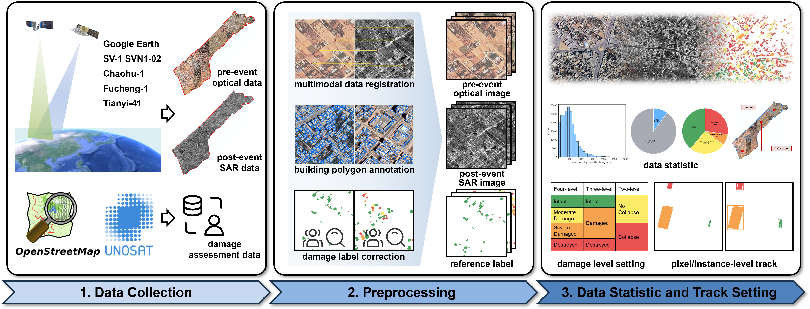

# Multimodal Building Damage Assessment for War Disasters based on Frequency-Domain Fine-Tuned Visual Foundation Model

Tianyu Wei¹, He Chen¹, Ailong Ma², Zhuo Zheng³, Anzhu Yu⁴, Wenchao Liu¹, Jue Wang¹✉, Liang Chen¹, Yanfei Zhong²

¹ Beijing Institute of Technology
² Wuhan University
³ Stanford University
⁴ Information Engineering University

**Official repository of the GazaOS dataset and the MFTV model**

---

## Updates

> ⏳ The dataset and code are being prepared and will be released after acceptance.

---

## Overview

**GazaOS** is a large-scale, multimodal (optical–SAR) building damage assessment dataset for **war disasters**. It covers the **entire Gaza Strip (~350 km²)** at **0.5 m** resolution, with **210,693** annotated buildings and **4,415** optical–SAR image pairs, providing **4-level / 3-level / 2-level** damage tracks and both **pixel-level** and **instance-level** annotations.

**MFTV** (Multimodal Frequency-domain fine-Tuned VFM) is built on the pretrained **SAM2 Hiera** encoder, fine-tuned with modality-specific LoRA and the proposed **Low-Frequency amplitude Exchange LoRA (LFExLoRA)** for parameter-efficient fine-tuning, supporting pixel-level (MFTV-Seg) and instance-level (MFTV-Inst) BDA.

| Benchmark      |                   Best result                   | Task                     | Doc                                                          |
| :------------- | :----------------------------------------------: | :----------------------- |:-------------------------------------------------------------|
| Pixel-level    |     **60.13% mIoU** (2-level, Hiera-L)     | Dense damage mapping     | coming soon                                                  |
| Instance-level | **17.44% mAPₘₐₛₖ** (2-level, Hiera-B+) | Building-wise assessment | coming soon |

> **Why GazaOS?** Existing BDA datasets (xBD, Bright, etc.) mainly target natural disasters; war-induced damage exhibits fragmented and heterogeneous spatial distributions that hinder cross-scenario transfer. GazaOS fills the gap of a dedicated war-disaster BDA benchmark.

---

## Dataset

For the full dataset description (damage categories, data sources, annotation, split, directory structure).

  

---

## Method

**MFTV** (Multimodal Frequency-domain fine-Tuned Visual Foundation Model) is a parameter-efficient fine-tuning (PEFT) framework for multimodal war-disaster BDA. It is built upon the pretrained **SAM2 Hiera** encoder (kept frozen) and supports both pixel-level and instance-level damage assessment.

- **Modality-specific LoRA**: low-rank adapters are inserted in parallel with the MHSA and MLP layers of the Transformer blocks, independently adapting the frozen VFM representations to the optical and SAR modalities while preserving their distinct characteristics.
- **LFExLoRA** (Low-Frequency amplitude Exchange LoRA): at the four output stages of the backbone, the MLP-branch LoRA is replaced by LFExLoRA, which enables adaptive cross-modal low-frequency interaction in the frequency domain. It predicts **learnable low-pass filters** to adaptively select low-frequency components and learns **modality-specific exchange ratios** to control how much low-frequency amplitude information is exchanged between the optical and SAR features — thereby reducing optical–SAR discrepancies and facilitating war-induced building semantic change recognition.
- **Task-specific heads**: **MFTV-Seg** attaches a pixel-level segmentation decoder (following ChangeMamba) for dense damage mapping; **MFTV-Inst** attaches an instance segmentation head (following Mask R-CNN) for building-wise assessment.

With only **5.20M** trainable parameters (pixel-level, Hiera-B+), MFTV achieves **60.13% mIoU** (pixel-level) and **17.44% mAPₘₐₛₖ** (instance-level) on GazaOS.

---

## Acknowledgments

The dataset construction acknowledges the following public data and resources:

- Building footprints: OpenStreetMap (OSM)
- Damage reference labels: UNOSAT emergency mapping products
- Pretrained backbone: SAM2